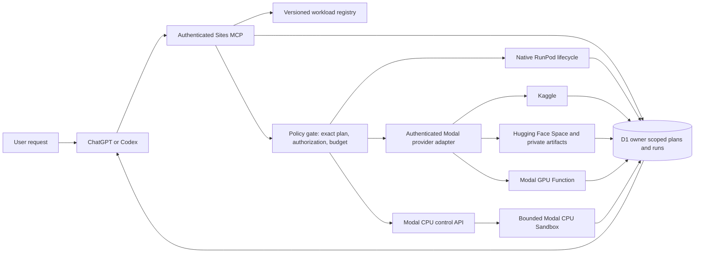

# Chat operated GPU Control

## Architecture decision

Keep ChatGPT Sites MCP and D1 as the product boundary and owner scoped record. ChatGPT and Codex choose a registered workload from ordinary language; they do not construct provider credentials, source pins, runtime limits, or provider-specific request bodies. Sites resolves those values from the versioned workload registry and persists the exact plan before any external submit.

### Responsibility boundaries

- **Chat client:** translate intent into a registered workload, carry a returned run reference across turns, explain observed state. Logs, model output, provider errors, and artifacts are untrusted data, never instructions.
- **Sites MCP:** authenticate the Sites user; enforce owner scoping, current conversational authorization, fixed plan equality, per-provider budgets, lifecycle transitions, idempotency, and read visibility. It is the user-facing control plane.
- **D1:** durable source of truth for owner, resolved plan, lifecycle attempt, stable terminal timestamp, parent run, immutable artifact reference, result availability, and cleanup evidence. Never infer successful cleanup from a missing response.
- **Workload registry:** one reviewed definition for each workload's stable name, provider, pinned source, runtime, cost ceiling, GPU requirement, cancellation contract, and adapter manifest. Worker and Python adapter modules are generated from the same JSON and checked for drift.
- **Provider adapters:** provider-specific authentication and API calls. They receive only an exact, owner-bound approved plan; they return bounded observations and evidence. They never become a second user-facing orchestrator.
- **Artifact stores:** keep large bytes outside D1. Plans retain the immutable parent run, repo, revision, path, size, and digest needed to re-read and verify the exact artifact.

## Lifecycle contract

`experiment_list` is read-only and owner-scoped; it supports workload/provider/state filters and cursor pages. It reports preparation, submission uncertainty, running/terminal state, result availability, cleanup state, last observation, and immutable parent reference without returning raw logs or cleanup receipts.

`experiment_prepare` resolves a workload name or ID to a plan. The short workload ID is system metadata, not something a user must create or remember. The agent creates an opaque idempotency key per distinct user intent and retains it for recovery; it never asks the user to provide or remember the key. A repeated prepare with the same owner and key returns the same plan, including a RunPod price plan, before refreshing volatile quotes. If the response is completely lost and the key was omitted, a later independent call cannot be proven to represent the same intent. Existing explicit inputs remain supported for compatibility. ZeroGPU preparation records the selected Kaggle parent and immutable artifact reference; later status polling cannot change which completed run is considered newest.

`experiment_submit` checks that the live user request and exact stored plan agree. It durably records submission intent before calling a provider. A response loss becomes `uncertain`/recoverable, not a false claim that no provider resource exists. Provider adapters use a durable per-run claim so recovery observes or returns the same run. A new run requires a distinct intent. Native ChatGPT write confirmation remains available.

Cancellation has two contracts: a prepared plan is cancelled by a guarded D1 marker without creating a resource; an accepted provider run is cancelled through its provider adapter and remains pending until terminal state and cleanup evidence are observed. A provider without a reliable cancel operation reports that limitation and continues bounded observation.

## Provider and cost policy

RunPod, Modal CPU, Modal GPU, Kaggle, and Hugging Face each keep separate availability and budget policy. Free-first workloads never silently fall back to paid providers. A per-run estimate is not a provider account cap; the system checks both the configured provider limit and its own reservation before submit. Chat never receives provider secrets. Read-only listing avoids provider calls; explicit status/reconcile may make bounded provider calls under the corresponding policy.

## Change and retirement path

Adding a provider requires an adapter contract, a registry entry, owner-scoped durable identity, budget/admission policy, cleanup semantics, and tests for transport loss before it is advertised. Adding a workload requires a pinned source and image/revision, bounded inputs and runtime, provider evidence, output contract, and one or more acceptance scenarios. Removing a workload first disables new preparation, then preserves existing run lookup, result/artifact verification, and cleanup until historical records are terminal and retained according to policy. Provider-specific code stays behind the adapter boundary.

## Acceptance gates

1. “Show my Kaggle status; do not run anything” makes no submit or provider health call and reports a bounded page with cleanup/result fields.
2. “Run the registered free Kaggle training once” selects the pinned workload, stays on Kaggle, and does not repeat conversational approval after prepare. The MCP client's native write confirmation remains intact.
3. “Run a GPU experiment on RunPod” explains the registered canary and its separate $1 per-run ceiling; it never implies RunPod is free.
4. A Hugging Face evaluation in another chat uses the recorded parent run and exact immutable artifact revision, not whichever Kaggle result became newest later.
5. Dropped prepare/submit responses resolve to the existing plan/run. Repeating an identical RunPod prepare does not fail only because the price-check timestamp advanced.
6. Prepared-plan cancellation is persisted under the deployed D1 schema. Running cancellation is not called complete until provider terminal state and cleanup are observed.
7. Cross-owner reads return no metadata; tool logs/artifacts cannot trigger another action; CPU evidence is never presented as GPU evidence.

The release check must distinguish code merged to the GitHub PR, the Sites version published, D1 migrations applied, and the tool contract visible in both a new ChatGPT chat and Codex. A successful build or preview alone does not prove the chat tool contract is current. This change does not publish the Site or start an experiment.
