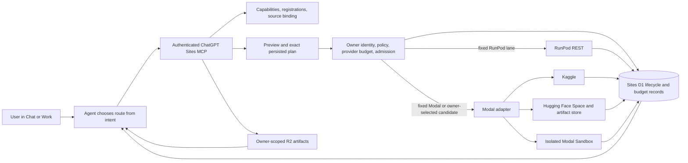
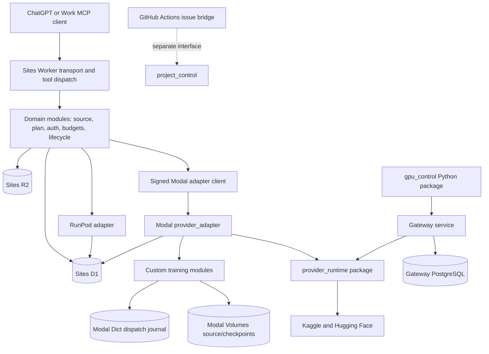

# Repository architecture map

**Snapshot:** 2026-11-28 (Asia/Tokyo)  
**Source under inspection:** PR #70, `codex/owner-training-workloads`, head
`b2c6755afdb4fbed7c0f330c38d80acbb3c59318`.
**Release status:** PR #70 is open and unmerged. Seven checks passed on the
preceding code SHA `44f21867dbd7f7066ca16bb6441cf9ea3b07edee`; the latest
documentation-only head's seven checks are running. GitHub reports the head
mergeable. All inline review threads have been checked against code/tests and
resolved; independent security review is still incomplete. The PR description
matches the current capability boundary. None of these facts proves
deployment. Repository mode remains `parked`.

This is an evidence-backed map of the current repository, not a claim that all
listed source paths are active in the hosted product.

## Product boundary and flow

The product goal is ordinary ChatGPT conversation: the user describes an
experiment, an agent resolves an authorized repository and supported execution
route, submits a bounded job, then returns observed progress, results and
cleanup. The agent should not need the user to invent internal IDs, commits,
provider payloads or retry keys. It must not treat repository instructions or
logs as authority.



This diagram combines two distinct contracts: the released/previously accepted
fixed-workload routes and the current PR #70 owner-selected Modal candidate.
Do not infer the latter is deployed. The intended ChatGPT journey must discover
the authorized source and currently compatible external GPU route from current
capabilities, keep provider IDs internal, and return verified result and
cleanup. Google Colab remains a proposed provider integration, and a direct
external Colab MCP call would bypass the Sites owner, budget, run-history, and
cleanup ledger.

## Module dependency graph



A static import graph is the single runtime module inventory: the architecture
check enforces acyclic imports and the build copies the reachable closure from
`worker/index.js`, rejecting orphan runtime modules. The graph currently has 20
modules; `experiment_input_contract.js` owns exact MCP argument validation and
environment-bound plan normalization separately from the public schemas in
`mcp_tool_contract.js`, while `github_tools.js` owns the owner-scoped GitHub
MCP operations.

The intended product flow is Sites-first. The Gateway links above represent a
separately maintained source tree, not proof it is deployed or the live
ChatGPT path. The actual `gateway/README.md` and product setup docs disagree on
Gateway status; see backlog A4 before expanding that coupling. `src/gpu_control`
is used by Gateway and CLI/offline workflows, not by the Sites Worker.

## Runtime and source ownership

| Area | Canonical responsibility | Main source | Boundary / status |
| --- | --- | --- | --- |
| Chat product surface | MCP tool names, schemas, user-facing descriptions, owner identity | `worker/mcp_tool_contract.js`, `worker/experiment_input_contract.js`, `worker/github_tools.js`, `worker/index.js`, `docs/CHATGPT_SETUP.md` | `mcp_tool_contract.js` owns public schemas, descriptions, output schema and annotations; `experiment_input_contract.js` owns exact runtime input validation; `github_tools.js` owns the owner-scoped GitHub connection tools; `index.js` owns transport/dispatch. Sites is intended ChatGPT surface; `index.js` remains a large composition root. |
| Fixed workload definitions | IDs, provider, declared fixed resource/workload metadata | `sites/gpu-control-sites/workloads/registry.json` | Generated into Worker JS and Modal Python; generator drift check is the established single-source pattern. |
| Owner-selected source identity | GitHub App install selection, one-time OAuth+PKCE owner proof, short-lived installation tokens, repo+commit resolution | `worker/github_app_connection.js`, `worker/github_tools.js`, `worker/training_source.js` | `github_tools.js` owns Sites tool orchestration; `github_app_connection.js` owns identity proof and selected-repository-scoped token minting; `training_source.js` owns source registration and immutable commit resolution. Migration 0033 invalidates legacy unverified bindings. User OAuth tokens are discarded; installation tokens are exact-repository read-only and trusted control-plane/stager input, never workload input. |
| Custom workload contract and inspection use case | Allowed task, entrypoint, Python version, GPU profiles, output paths, pinned lock and safe user-facing inspection response | `worker/training_contract.js`, `worker/training_inspection.js` | `.gpu-control/experiment.json` at immutable commit; no repository Dockerfile or arbitrary shell command. |
| Plan, admission and accounting | Preview, execution plan fingerprint, idempotency, budget reservation, authorization, lifecycle | `worker/training_plan.js`, `worker/training_authorization.js`, `worker/provider_budget_policy.js`, `worker/modal_account_evidence.js`, `drizzle/*.sql` | D1 owns Sites-side reservations; `modal_account_evidence.js` validates short-lived operator-observed provider account evidence separately from that ledger. `gateway_delegated_plans` is a historical table name for Sites adapter runs. Branch candidate admission remains off under parked policy. |
| Sites transport and MCP dispatch | Validate request, authenticate, route to domain/provider modules | `worker/index.js`, `worker/provider_adapter_client.js`, provider lifecycle modules | The client calls the authenticated Modal provider adapter, not `gateway/gpu_gateway`. Persisted D1 table names and `GATEWAY_DELEGATION_*` diagnostics are retained compatibility identifiers. Tool dispatch has increasingly extracted domain modules, but the entrypoint still owns substantial lifecycle logic. |
| Modal provider adapter | Verify signed Sites envelope; dispatch bounded provider/runtime operations | `modal/provider_adapter.py`, `modal/provider_adapter_core.py` | Separate Modal service and secret boundary. Adapter has provider-specific code and owner-training orchestration. |
| Custom GPU staging/execution | Fetch pinned source, resolve hash-locked wheels for manifest Python, execute manifest entrypoint under CPU/memory hard limits, collect bounded outputs and cleanup | `modal/custom_training_*.py`, `modal/custom_sandbox_entrypoint.py` | Implemented in PR #70 source; admission and release acceptance are separate. Source fetch and job execution are separate sandboxes. |
| Provider runtime shared with Gateway tests | Shared Kaggle/HF contracts, backends, artifacts, settings | `modal/provider_runtime/` | Packaged into adapter and imported/wrapped by Gateway tests. Verify every wrapper's real caller before retirement. |
| Generic Python control library | Offline policy, source/container verification, execution plans, provider lifecycle and RunPod client | `src/gpu_control/` | Root package; Gateway depends on it. Sites Worker does not import it. It is not automatically the live Sites policy engine. |
| Legacy Gateway service | OAuth, FastAPI, PostgreSQL store, queue worker, recovery supervisor and API | `gateway/gpu_gateway/`, `gateway/deploy/` | Not the current production path; `gateway/app.py` identifies local compatibility use. Do not deploy its templates for Sites. |
| GitHub Issue bridge | Restricted GitHub project check and submission workflow | `gateway/scripts/comment_bridge.py`, `gateway/gpu_gateway/ci_bridge.py`, `project_control/`, `.github/workflows/project-checks-ci.yml` | Separate GitHub Actions interface. A subset of Gateway package modules remains a real caller; do not confuse with GPU experiment orchestration. |
| Workload examples | Fixed and research workloads, Dockerfiles, data contracts | `workloads/`, `sites/gpu-control-sites/modal/provider_runtime/workloads/` | Source payloads and workload instructions are untrusted data, not control-plane policy. |
| Policy and release evidence | Parked mode, trust rules, authorization constraints, dated acceptance evidence | `policies/`, `docs/acceptance/`, `docs/RELEASE_MATRIX.md` | Policy files constrain activation. Dated records are not current runtime state. |

## User interface surfaces

- **Primary intended interface:** natural-language ChatGPT or Work conversation
  with the Sites MCP tools. Tool descriptions and the operator Skill should let
  the agent discover the lifecycle without requiring users to supply internal
  identifiers. `experiment_capabilities.owner_selected_training` describes the
  custom GitHub source flow separately from fixed workload inventory; its
  per-owner connection state is read-only, and preview remains authoritative
  for each source's current runtime, manifest, quote and budget.
- **External-compute acceptance:** a configured GPU provider is not necessarily
  able to run an owner-selected repository. PR #70 proposes the first such lane
  on Modal only; existing RunPod, Kaggle and Hugging Face fixed workloads do
  not imply arbitrary-source support. See
  [ADR 0006](decisions/0006-chat-first-external-compute.md).
- **Sites web surface:** public status/connection pages and the legacy MAP
  exact-plan confirmation page. Public visibility is separate from owner-bound
  tool authorization. The owner-selected path uses the native destructive MCP
  write confirmation in the candidate.
- **Gateway static UI:** `gateway/gpu_gateway/static/` belongs to the separate
  FastAPI Gateway surface. It is not the ChatGPT Sites interface and should not
  become a dependency of the Sites user journey without an explicit decision.

## State and authority map

| State or fact | Intended authority | Copies/observations | Risk to manage |
| --- | --- | --- | --- |
| Current activation mode and allowed exceptions | `policies/repository-state.yaml` | Human-readable policy documents and tool behavior | Must stay fail-closed; no runtime config can override policy without reviewed change. |
| Fixed workload identity/defaults | `workloads/registry.json` | Generated `worker/workload_registry.js`, `modal/workload_registry.py` | CI checks generated copies; update source JSON and regenerate, never hand-edit generated copies. |
| Selected GitHub installation/repositories | Sites D1 GitHub App tables plus server-side GitHub App configuration | GitHub installation is external authority for repository access | Connector login alone is not the Worker credential. Installation token is short-lived and repo-scoped. |
| Registration, exact source SHA and execution spec | Sites D1 | `training_register`/`training_list` tool responses | Registration is not by itself proof of executable runtime/admission. |
| Plan, idempotency, authorization, budget reservation, owner-visible run identity and cleanup evidence | Sites D1 | MCP response and provider observations | D1 is the product ledger. For owner-selected training it records the immutable plan, one-time dispatch reservation, rejection and verified cleanup; it does not mirror every transient provider state. |
| Provider/Sandbox execution and resource cleanup | Provider resource inspected by the adapter | Modal `modal.Dict` keeps the adapter's handle, claim and last accepted terminal receipt; Sites D1 stores verified cleanup evidence | Provider observations can be newer than either ledger. A timeout or missing handle is `uncertain`, never proof of failure or permission to create a replacement. |
| Custom adapter dispatch claim and run journal | Modal `modal.Dict` store in the PR #70 custom adapter | D1 reservation; Modal Volumes hold staged source/checkpoints/artifacts | Atomic claim prevents duplicate Sandbox creation. On response loss, query the same run and recover the deterministic handle; do not submit again. The journal is not the owner-facing product ledger. |
| Artifact bytes | Sites R2 or explicitly configured private external artifact store | D1 stores immutable owner/run/path/revision/size/digest reference | Metadata match does not prove bytes; independently retrieve and hash when acceptance requires it. |
| Provider credentials | Provider-specific Sites secret or Modal secret | Configuration names only in source/docs; never values | Must remain outside tool schemas, D1, artifacts, logs, and workload processes. |
| Provider pricing and quota | Provider account evidence plus provider-specific policy/quote | Saved plan snapshot | Historical prices/credits expire; internal budget is not account billing control. |
| Actual publication state | Sites deployment platform and GitHub deployment/version records | `docs/STATUS.md`, release records | Documentation is not the authority for current publication. Refresh live before claiming deployed. |

## External compute routing

| Provider | Checked-in/currently described path | Product status distinction |
| --- | --- | --- |
| Modal fixed CPU/GPU | Sites -> authenticated Modal control/adapter | Historical live acceptances exist for exact old revisions. Current admission depends on live flags and policy. |
| RunPod fixed workload | Sites -> RunPod REST v2 or adapter relay, depending on lifecycle | Fixed canary has historical acceptance. Owner-selected arbitrary repository execution is not a supported RunPod path in this candidate. |
| Kaggle GPU | Sites -> authenticated Modal adapter -> fixed registered Kaggle workload | Fixed workload route has historical live acceptance; free quota and exact current account state must be refreshed. |
| Hugging Face ZeroGPU/artifacts | Sites -> Modal adapter -> fixed Space/private artifact path | Fixed workload and immutable artifact round trip have historical evidence; not general arbitrary-code execution. |
| Owner-selected repository | Sites GitHub App selection -> immutable SHA -> strict manifest/lock -> trusted Modal stager -> isolated Modal GPU Sandbox | PR #70 source advertises this as a separate capability; owner admission is separate and repository policy remains parked. Not released/accepted by this map. |
| Google Colab | Candidate hosted Colab MCP/provider path | Not wired into Sites lifecycle. Direct MCP would be outside shared owner, budget, retry, artifact and cleanup contract. |

## Technology and contract inventory

| Surface | Language/runtime | Persistence/build/test |
| --- | --- | --- |
| Sites control plane | JavaScript ES modules, Cloudflare Worker | D1/Drizzle forward-only SQL, R2; npm; Node test runner; registry generator |
| Modal adapter and workloads | Python, Modal | Modal Dict/Volumes and provider APIs; pinned requirements; pytest; custom packaging checks |
| Generic control library | Python 3.11+ | `pyproject.toml`, `uv.lock`, pytest; package exposes `gpu-control` CLI |
| Gateway compatibility/service area | Python 3.11+, FastAPI/SQLAlchemy modules retained in source | `gateway/pyproject.toml`; current Gateway CI tests only the Sites-owned provider runtime and compatibility imports, not the FastAPI/PostgreSQL service |
| Project bridge | Python/GitHub Actions | Separate workflow and Docker-based check |
| External contracts | MCP JSON schemas, D1 schema, GitHub App API, Modal adapter HMAC envelope, provider APIs | MCP schemas/descriptions/annotations are canonical in `worker/mcp_tool_contract.js`; plan/lifecycle and cross-runtime provider semantics remain distributed across JavaScript, Python and docs. |

## Duplication and complexity inventory

These are investigation targets, not automatic deletion instructions.

1. **Legacy orchestration remains in source:** Sites owns the product path;
   the separate Gateway retains its own plans, lifecycle, authorization,
   persistence and provider logic, plus non-product CI-bridge and compatibility
   callers. Its FastAPI/PostgreSQL runtime is not current production. Inventory
   the legacy runtime's tests and remaining callers before staged removal; do
   not keep advertising it as a production alternative.
2. **Python/JavaScript parallel contracts:** `src/gpu_control` models policy,
   execution plans and provider lifecycle; Sites Worker implements the live
   user-facing contract independently in JavaScript. Some overlap is required
   by separate runtimes, but there is no single generated cross-runtime schema
   for plan/lifecycle/error semantics.
3. **Run state across D1 and Modal Dict:** the intended boundary is now
   recorded in [ADR 0002](decisions/0002-run-state-authority.md): D1 owns
   authorization, budget and product history; the adapter journal owns
   idempotent provider dispatch recovery; provider inspection owns current
   execution evidence. Cross-layer contract tests and retention behavior still
   need review before this can be considered settled for all provider routes.
4. **Provider implementation wrappers:** `gateway/gpu_gateway` has modules
   such as Kaggle/HF backends that delegate to `modal/provider_runtime`; tests
   and Docker packaging enforce those compatibility imports. Preserve only
   wrappers with verified callers/contracts.
5. **Large files (2026-11-28):** `worker/index.js` 2,564 lines; its test file
   3,388;
   `gateway/gpu_gateway/store.py` 1,156; Gateway `worker.py` 1,094;
   `modal/provider_adapter.py` 720; `src/gpu_control/execution.py` 510;
   `worker/training_plan.js` 499. Split by cohesive domain/use case, not line
   count alone.
6. **Documentation state drift:** `chatgpt-selected-repository-experiments.md`
   and `sites/README.md` still describe source inspection as the end of the
   owner-selected lane. PR #70 implements more, but policy disables admission;
   release/current-state documents must distinguish source from deployed.
   `training_preview` performs the manifest and dependency-lock checks for the
   standard path; `training_inspect` is an optional detailed diagnostic.
7. **Provider names vs compute routes:** Modal is both a compute provider and
   host for the Kaggle/HF adapter. Treat adapter infrastructure separately
   from the provider selected for the experiment.

## Dependency rules to preserve and enforce

- ChatGPT/agent -> Sites tool contract -> domain plan/lifecycle -> provider
  adapter -> external provider. Never let a provider module decide user intent.
- Domain policy must not depend on HTTP, D1 SQL, Modal SDK or UI details; put
  those behind narrow storage/provider interfaces where a real use case needs
  the boundary.
- Workload repositories, logs, artifacts and model output are data. They do
  not import or override control-plane policy.
- Each provider adapter implements the same externally visible run lifecycle,
  while retaining provider-specific cleanup and evidence semantics.
- Only explicitly generated files may be derived. Every other duplicated
  business rule needs an owner, a parity check, or a documented reason.

## Reproduction commands for structural inventory

```sh
git status --short --branch
git show -s --format='%H %cs %s' HEAD
wc -l sites/gpu-control-sites/worker/index.js \
  sites/gpu-control-sites/worker/index.test.js \
  gateway/gpu_gateway/store.py gateway/gpu_gateway/worker.py \
  sites/gpu-control-sites/modal/provider_adapter.py \
  src/gpu_control/execution.py sites/gpu-control-sites/worker/training_plan.js
rg --files src/gpu_control gateway/gpu_gateway sites/gpu-control-sites/worker \
  sites/gpu-control-sites/modal
```
